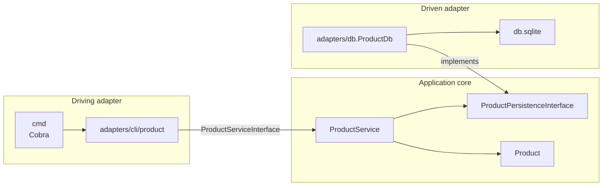

# gohex

gohex is a command-line product catalog built to show hexagonal architecture in Go. Creating a product, loading it, and deciding whether it can be enabled or disabled are use cases in the application core. The core talks to the outside world only through interfaces: a Cobra command drives those use cases, and a SQLite adapter implements persistence. The rules can be tested with mocks, and the database can be replaced without rewriting them.

## Tech stack

- **Go 1.16** (`go.mod`). Persistence uses [`github.com/mattn/go-sqlite3`](https://github.com/mattn/go-sqlite3), a cgo driver, so a C compiler is required and `CGO_ENABLED` must stay on.
- **[Cobra](https://github.com/spf13/cobra)** for the `gohex` command.
- **SQLite**, via `database/sql`. The process opens `db.sqlite` in the working directory.
- **[google/uuid](https://github.com/google/uuid)** for product ids and **[govalidator](https://github.com/asaskevich/govalidator)** for struct checks inside `Product.IsValid`.
- **[testify](https://github.com/stretchr/testify)** and **[golang/mock](https://github.com/golang/mock)** in the tests. Generated mocks are committed at `application/mocks/application.go`.
- A **Docker** dev image (`golang:1.16`) in `Dockerfile` and `docker-compose.yaml`.

## Architecture

Imports point inward. `adapters`, `cmd`, and `config` import `application`. The application package itself imports only the standard library, `govalidator`, and `uuid`.



`config.InjectService` is the composition root. It opens `db.sqlite`, wraps the connection in `ProductDb`, stores that value on `ProductService.Persistence`, and returns the service as a `ProductServiceInterface`. `cmd/root.go` calls it from a package-level variable, so the database opens when that package is initialized. The `cli` command passes the service into `adapters/cli/product.Run`.

### Ports

The ports are the interfaces in `application/product.go`.

| Port | Direction | Methods |
| --- | --- | --- |
| `ProductInterface` | Entity | `IsValid`, `Enable`, `Disable`, `GetId`, `GetName`, `GetStatus`, `GetPrice` |
| `ProductServiceInterface` | Inbound, used by the CLI | `Get`, `Save`, `Enable`, `Disable` |
| `ProductReader` | Outbound | `Get(id)` |
| `ProductWriter` | Outbound | `Save(product)` |
| `ProductPersistenceInterface` | Outbound | Embeds `ProductReader` and `ProductWriter` |

`ProductService` depends on `ProductPersistenceInterface`. It has no SQL and no flag parsing.

### Adapters

The driving adapter is `adapters/cli/product`. `Run` switches on an action string and calls the service. `cmd/cli.go` exposes that function as the Cobra command `gohex cli`.

The driven adapter is `adapters/db.ProductDb`. `Get` selects one row from `products`. `Save` chooses between an insert and an update, then returns the same `application.ProductInterface` the service passed in. That signature is what makes `ProductDb` a valid persistence port.

## Domain rules

A product has an id, a name, a price, and a status of `enabled` or `disabled`.

`NewProduct` assigns a UUID v4 and sets status to `disabled`. `ProductService.Save` fills in the name and price, refuses the product when `IsValid` fails, and then calls the persistence port.

`IsValid` requires a non-empty id, a non-empty name, a price greater than zero, and a status of `enabled` or `disabled`. An empty status is treated as `disabled`. The method then validates the struct with govalidator: `ID` is tagged `uuidv4` and `Name` is tagged `required`.

`Enable` sets status to `enabled` when the price is greater than zero. Otherwise it returns `price must be greater than zero to enable the product`.

`Disable` returns `Product is already disabled` when the status is already `disabled`. It sets status to `disabled` when the price is exactly zero. Any other price returns `price must be zero to disable the product`. A product that passes `IsValid` has a price greater than zero, so disabling it requires the price to be changed to zero first. The CLI has no command that changes the price of an existing product.

## Layout

```
.
├── main.go                      # calls cmd.Execute
├── cmd/
│   ├── root.go                  # builds the service and the root command
│   └── cli.go                   # flags and the cli subcommand
├── config/config.go             # wires ProductDb into ProductService
├── application/
│   ├── product.go               # entity, status constants, ports
│   ├── product_service.go       # use cases
│   ├── product_test.go
│   ├── product_service_test.go
│   ├── mocks/application.go     # mockgen output
│   └── sqlite.db                # unused by the running program
├── adapters/
│   ├── cli/product/             # driving adapter and its test
│   └── db/                      # SQLite adapter and its test
├── db.sqlite                    # file opened at runtime
├── Dockerfile
├── docker-compose.yaml
├── go.mod
└── go.sum
```

## Run locally

Use Go 1.16 or later and a C compiler such as gcc. From the repository root:

```bash
go run . cli --help
```

To build a binary:

```bash
go build -o gohex .
./gohex cli --help
```

`go build` and `go run . cli --help` were run with Go 1.22.2 and gcc. The module's declared language version remains Go 1.16, which is also the version in the Docker image.

The repository includes `db.sqlite` with the table the adapter expects and a handful of rows. The program leaves schema creation to that file. For a new database in the current directory:

```bash
sqlite3 db.sqlite "CREATE TABLE products (
  id string,
  name string,
  price float,
  status string
);"
```

`create` and `enable` append rows to whichever `db.sqlite` is in the working directory, including the file tracked in this repository.

### Docker

The compose file builds a dev container named `appproduct`, publishes port `9000`, and bind-mounts the repository at `/go/src`. The image installs `sqlite3`, `mockgen` v1.5.0, and `cobra-cli`, then runs as `www-data`. Its command is `tail -f /dev/null`, so the container stays up for a shell. The Go program is started by hand:

```bash
docker compose up --build -d
docker compose exec app go run . cli --help
```

## Usage

```text
gohex cli [flags]

  -a, --action string   enable / disable a product (default "enable")
  -i, --id string       Product id
  -n, --name string     Product name
  -p, --price float     Product price
```

| Action | Example | Service calls |
| --- | --- | --- |
| `create` | `go run . cli -a create -n "Notebook" -p 19.9` | `Save`. The new row is stored as `disabled`. |
| `get` | `go run . cli -a get -i <id>` | `Get`. |
| `enable` | `go run . cli -a enable -i <id>` | `Get`, then `Enable`, then `Save`. This is the default action. |
| `disable` | `go run . cli -a disable -i <id>` | `Get`, then `Disable`. |

Creating a product prints the new id. The line is the format string in the CLI adapter, so it starts with the word "enabled" even though the stored status is `disabled`:

```text
Product 1afed169-3962-48ad-819e-d2fc96568cbc enabled, name: Notebook, price: 19.900000, status: disabled
```

This id is already in the committed database:

```bash
go run . cli -a get -i d38114e8-fcfe-4ef6-b1ff-cc500d628b0d
```

```text
product with name Product has been created with the price 25.000000 and status of disabled
```

Rejected input prints the validation error on its own line:

```bash
go run . cli -a create -n "Notebook" -p 0
```

```text
price must be greater than zero
```

```bash
go run . cli -a create -p 10
```

```text
name is required
```

`enable`, and any action other than `create`, `get`, or `disable`, returns a missing id as `sql: no rows in result set`. `get` and `disable` ignore the error from `Get`. With a missing id those two actions panic on a nil product.

### How save, enable, and disable hit SQLite

`ProductDb.Save` looks up the id and scans it into an `int`. A UUID does not scan into that variable, the lookup error is ignored, the value stays `0`, and `Save` takes the insert branch. `Get` returns the first row for that id. The update branch runs `UPDATE products SET name = ?, price = ?, status = ? WHERE id = ?` with no arguments bound, so it has no values to write. An `enable` of an existing UUID therefore inserts a second row with status `enabled`, and a later `get` still prints the original row.

`disable` ignores errors from both `Get` and `Disable`. For a product that is already `disabled`, the service returns `Product is already disabled` and an empty product, and the adapter prints a line from that empty value. `Disable` reaches the price check only when the status is `enabled`; any price other than zero then returns `price must be zero to disable the product`, and the same empty product is what gets printed.

## Tests

```bash
go test ./...
```

The suite passes. `application` checks the entity rules and the service methods `Get`, `Save`, `Enable`, and `Disable`, with `ProductPersistenceInterface` mocked by gomock. `adapters/cli/product` checks the `create`, `disable`, and `get` actions. `adapters/db` checks `Get` and `Save` against an in-memory SQLite database.

The domain package on its own:

```bash
go test ./application
```
